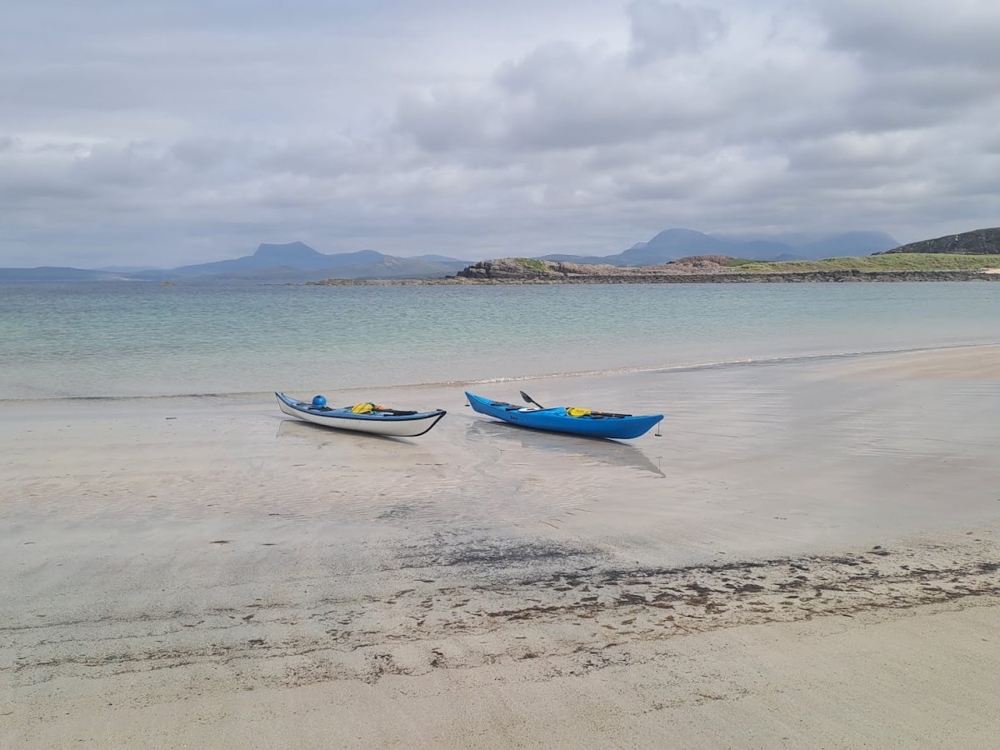
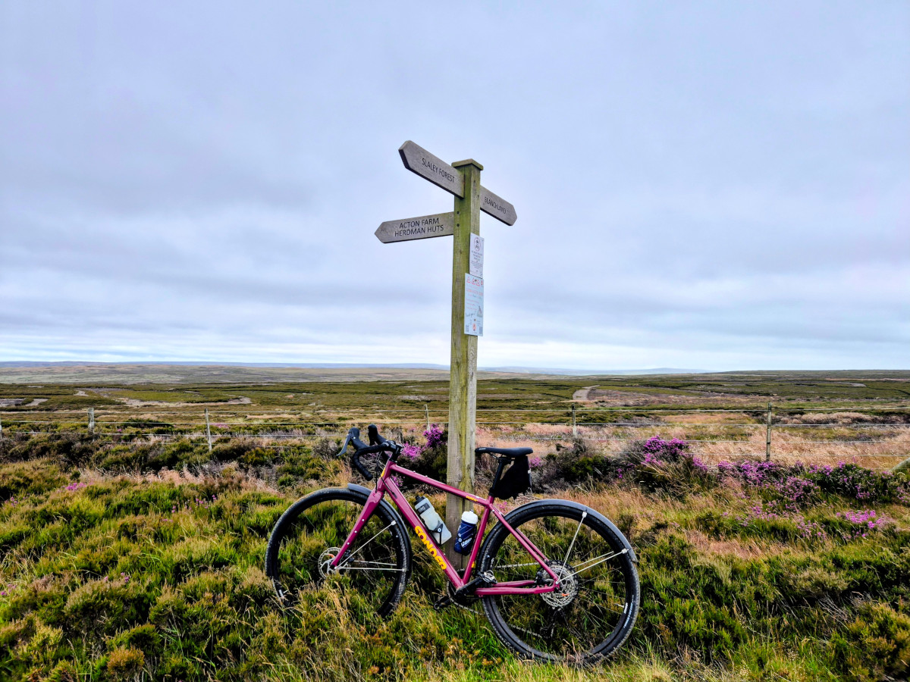
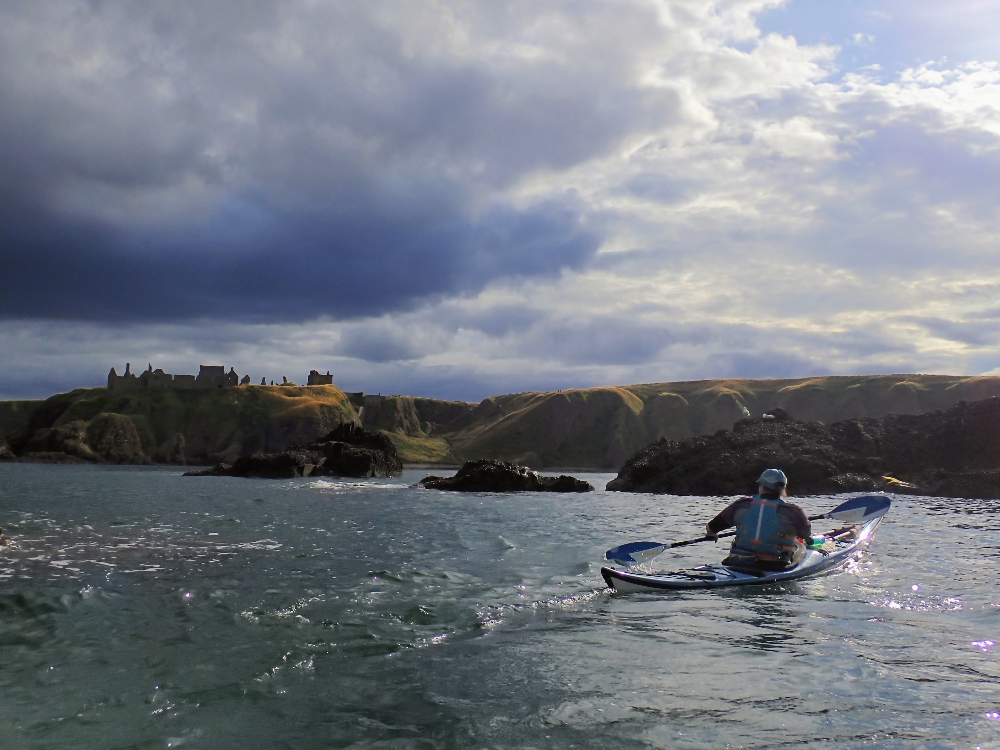
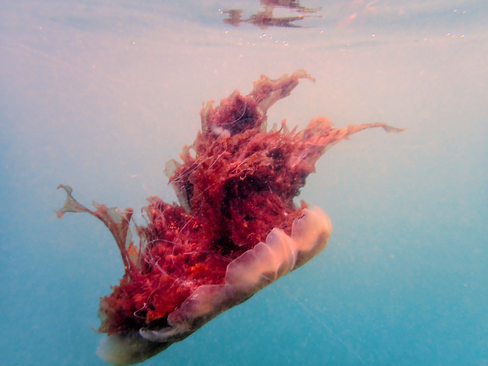

_Updated 2026-10-23. Inspired by [Derek Sivers](https://nownownow.com/about)._

I’ve had a fabulous summer [paddling in Scotland](http://rhionthesea.netlify.app/). Now, I’m looking forward to a cosy autumn, planning what to do in my garden next spring and playing some [games](https://steamcommunity.com/id/thetrianglegirl/). Despite the darker days, I intend to keep playing outside, going for sunrise swims, getting out on my gravel bike in dark and getting to know the Cheviots better. 

::: {layout-ncol=4}

{fig-alt="Two blue sea kayaks on a quiet, clear, sandy beach" group="my-gallery"}

{fig-alt="Red gravel bike up against a wooden signpost on the moors. Purple and green heather is thick on the ground." group="my-gallery"}

{fig-alt="A paddle looks up at a castle. The sky is moody." group="my-gallery"}

{fig-alt="A bright red lions mane jelly fish against a blue sea" group="my-gallery"}

::::

In work I'm doing some really interesting consultancy for [GreenerNHS](https://www.england.nhs.uk/greenernhs/), helping them use python to orchestrate their SQL based pipeline. 
I'm also leading a national [RAP accelerator programme](https://the-strategy-unit.github.io/RAP-accelerator/) for senior NHS ICB analysts. Those conversations have got me thinking about what resources could help more NHS analysts use RAP. I've started developing some open-source content on Using GitHub for collaboration, Getting confident with git, and Practical analytical QA. If you're interested in helping me develop any of these materials, get in touch 😊

In community projects, I'm planning sessions for [RSS conference 2027](https://rss.org.uk/training-events/conference-2027/) and doing the finances for [rainbowR](https://rainbowr.org/).

