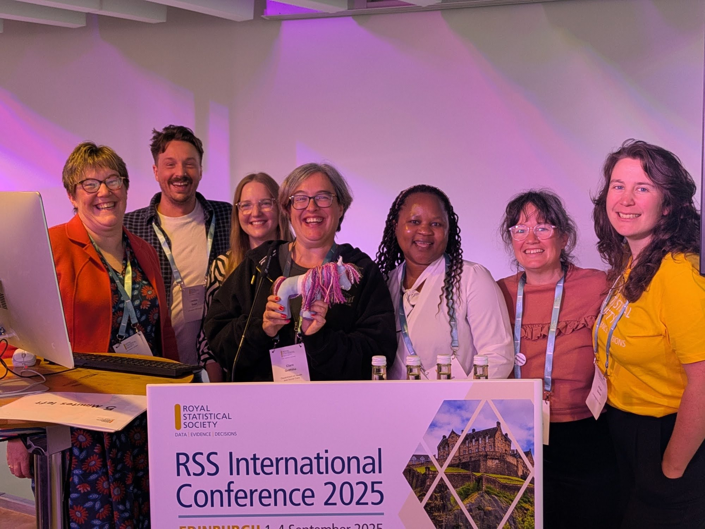
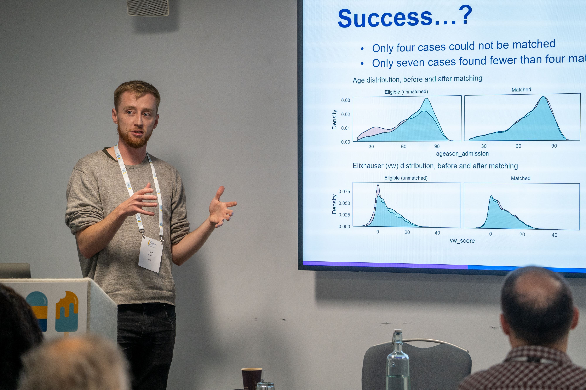
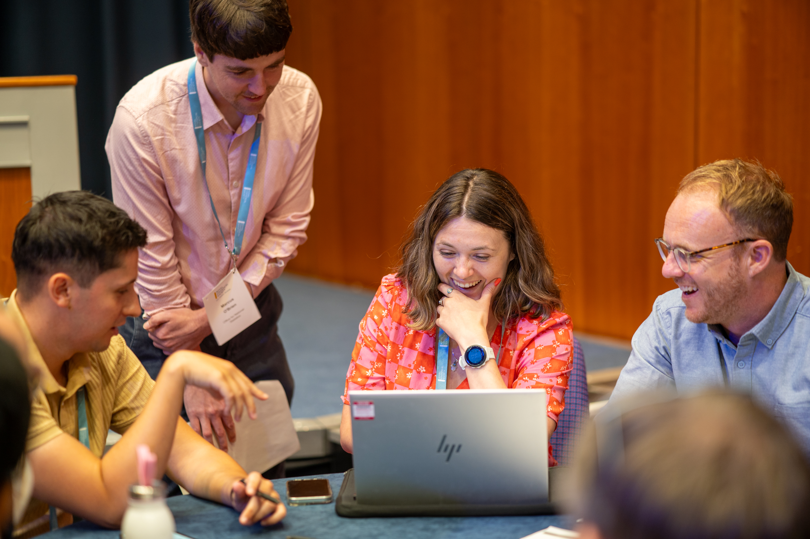

Have you ever sat in a conference session thinking "I wish there was a talk on X"? Well, at the [Royal Statistical Society International Conference](https://rss.org.uk/training-events/conference-2027/), you can make that happen. I've been attending for years and recently I've started putting together my own invited sessions on the topics I care about the most.

## Anyone Can Submit an Invited Session

The term "invited session" can be a little misleading. You don't have to be asked or specially invited to propose one. What it means is that you (or a small group) take responsibility for filling an entire slot (typically 80 minutes although check the [latest guidance](https://rss.org.uk/getattachment/Training-Events/Conference-2027/Invited-Topic-Sessions/Guidance-for-Invited-Session-organisers-RSS-2027.pdf.aspx)). It’s up to you to curate the theme, session format, timings and speakers.

{fig-alt="Seven people smiling behind a sign for the Royal Statistical Society International Conference 2025."}

## Choosing your theme and format

Start with a topic you are interested in. My own session grew out of a love of Reproducible Analytical Pipelines (RAP) in public health. I wanted to get a group of people in a room to nerd out about open source tools, data pipelines, and best practice. So I decided to build a session around it.
Once you have your theme, think about format. You have real creative freedom here. Some sessions are a couple of talks, others do a fireside chat, a debate or something more interactive. This year, [Nicola Rennie](https://nrennie.rbind.io/) organised a fantastic and highly entertaining [debate on the "rules" of data visualisation](https://virtual.oxfordabstracts.com/event/76886/session/197837). I chose four lightning talks showcasing RAP success stories in public health, followed by a "RAP clinic" where the audience could bring their own problems to the panel.

## Finding your speakers

Start with people you already know. I had friends at UKHSA and Public Health Wales who I knew were knowledgeable and engaging speakers. I wanted voices from other UK public bodies, but didn’t have speakers in mind from DHSC or PHS. I reached out through my contacts and asked for recommendations. You don't always need to know the right speaker personally, you just need to know someone who can put you in touch.

If you're not familiar with a potential speaker, do a little research. Look for talks they've given on YouTube, or ask colleagues who've seen them present. Being an engaging speaker matters as much as expertise.

A practical note on logistics: expenses for invited speakers are very limited and don't cover full attendance costs (check the [guidance notes](https://rss.org.uk/getattachment/Training-Events/Conference-2027/Invited-Topic-Sessions/Guidance-for-Invited-Session-organisers-RSS-2027.pdf.aspx) for details). It helps to prioritise speakers who are already planning to attend, or who are based locally and might welcome the chance to come for the day. Consider reaching out to local universities or businesses. It's a great way to make new connections too.

{fig-alt="Luke Shaw gives a presentation in front of a screen displaying statistical charts comparing age distributions."}

## Writing a Strong Submission

When you write your submission, include as much detail as possible. The stronger and more complete your submission, the better. If you're still confirming a speaker when you submit, be transparent about it. Note who your contact is and when you expect to confirm. It's not ideal, but showing you have a clear plan makes the session more likely to be accepted. At the time I submitted my session, I didn’t have one speaker confirmed, but I described my backup plan, and agreed to finalise speakers within the next month.

## Preparing for the session

Once your session is accepted, the real organising begins. I organised a virtual call to introduce my speakers to each other early so they could share ideas and write talks that complemented each others. One of them offered to do an introductory talk, so we put her first and the others built on it from there.
In the run-up to the conference I kept in regular contact with the speakers to make sure abstracts were submitted, registrations were sorted, and slides were in on time. I also made a [simple page](https://github.com/StatsRhian/RSS-rap-in-public-health/tree/main) pulling together all four presentations in one place, so attendees could find everything easily on the day. Since I was chairing the session, I made sure I knew how the speakers wanted to be introduced and put out a few posts on social media to advertise the session.

## Don’t forget about workshops

You can also offer to run a workshop. These often work well with just one or two speakers. I’ve previously run hand-on technical coding workshops e.g. [visualising spatial data](https://rhian.rbind.io/talks/2023-09-05-making-maps/), or learning to [build an R package](https://rhian.rbind.io/talks/2025-09-03-r-pkg/). Workshops don't have to be technical though, I’ve also worked with the [RSS Statistical Ambassadors](https://rss.org.uk/resources/find-an-expert/statistical-ambassadors/) to run an interactive session on [communicating statistics](https://virtual.oxfordabstracts.com/event/40660/program?session=103091&date=%222025-9-2%22). If you do submit a workshop, make sure the session teaches something rather than selling something —workshops aren’t the place for product pitches. (Although if you do want to pitch something to RSS attendees, consider being an [exhibitor](https://rss.org.uk/RSS/media/File-library/Conference/10165-RSS-2026-Conference-Sponsorship-AW1.pdf))

{fig-alt="Four people sit and stand around a laptop while looking at the screen and smiling during an RSS workshop"}

## Go for it

The RAP in Public Health session was one of my highlights of the 2025 conference. It was well attended, and I got to meet a bunch of people who are just as passionate about open source tools in public health as I am. That's the great thing about designing your own session.

Submissions for invited sessions are [now open for 2027](https://rss.org.uk/news-publication/news-publications/2026/general-news/submit-your-session-and-workshop-proposals-for-rss/). If you’d like to curate your own invited session:

- **Read the [guidance notes](https://rss.org.uk/getattachment/Training-Events/Conference-2027/Invited-Topic-Sessions/Guidance-for-Invited-Session-organisers-RSS-2027.pdf.aspx):** These cover everything you need to know before submitting: session formats, diversity expectations for your speaker lineup, how to request discounts for speakers, and key deadlines.
- **Draft your idea:** A theme, a format, and a couple of potential speakers is enough to get started, then sense check it with a friend

- **Talk to a stream coordinator:** Each stream has a number of coordinators. I coordinate the _Applications in Business, Industry & Finance_ and _Data Science & AI_ streams. If you have a rough idea and want a sense check or some advice on securing speakers, please do reach out. We're happy to help you design a great session. Contact details for stream coordinators are in the [guidance notes](https://rss.org.uk/getattachment/Training-Events/Conference-2027/Invited-Topic-Sessions/Guidance-for-Invited-Session-organisers-RSS-2027.pdf.aspx).

[Submit your session](https://rss.org.uk/news-publication/news-publications/2026/general-news/submit-your-session-and-workshop-proposals-for-rss/): The deadline is **20th November**.
