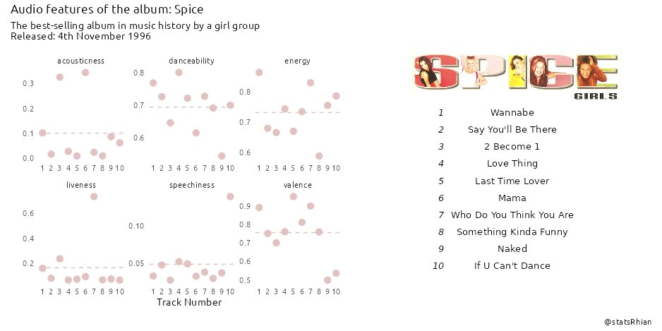

> This is a series of [tweets](https://statsrhian.github.io/tweets/) I wrote in 2021. 

I love the #TidyTuesday project and I always recommend it to my students as a way to skill up and get inspired. However, I rarely take part. I program in #RStats all day for work and my ridiculous collection of hobbies doesn't leave me with much spare time... 🧵

However, this week's data set is SPICE GIRLS. So inspired by [Nicola Rennie's](https://nrennie.rbind.io/) walk-through, I'm just gonna put the Spice album on and try and get a plot out on twitter by the time I get to the end. 39mins and 56 seconds. Okay... let's go.

### 🎵 "Wannabe"

What a TUNE. Okay, let's head to the repo and download the data. I'll try to keep things simple, so I'll ignore the (very interesting) lyrics data set and just look at the studio albums one.

### 🎵 "Say you'll be there"

I'll just focus on the Spice album. I briefly consider analysing musical key signatures and have ideas of making some sort of piano keyboard graph with {ggplot2}. TOO AMBITIOUS Rhi - keep it simple.

### 🎵 "2 Become 1"

I've mocked up a faceted scatter plot across six of the variables. To add a mean line for each facet I'll need to create a mini data set with the averages.

### 🎵 "Love thing"

I start to mess around with theme elements and colours and realise I could easily lose a few hours here. I'll just chose a nice Spice Girls pink, remove the grid lines and keep going.

### 🎵 "Last Time Lover"

This is the track with the highest "valence". I'd like to annotate some of data outliers - but annotating points on faceted plots is not trivial and we're almost half-way through the album. I settle for adding some fun facts to the subtitle instead.

### 🎵 "Mama"

Half-way through already! I kinda want to add the album cover in the plot somewhere. But I don't fully understand how grid and grobs work. {patchwork} can maybe help me? To Google!

### 🎵 "Who Do You Think You Are"

I have SO MANY TABS open right now. Frantically Googling and copy-pasting from StackOverflow - like a real programmer. 🤓

### 🎵 "Something Kinda Funny"

Gaah I wish I understood grobs properly.

Fun fact. Me and Mel B have the same birthday (29th May). I think Scary Spice probably suits me.

### 🎵 "Naked"

Really want to add the track listings somewhere too - `gridExtra::tableGrob()` looks like JUST what I need. And it comes with a minimal theme too. Thank you 🙏

### 🎵 "If U Can't Dance"

It's the last track on the album! There are so many things I want to tweak and improve but we're out of time. Is it a a great plot? No. Is it done? I guess 🤷‍♀️ It's hard to let go and I could play with the for ages - but it's time to commit and push. ⬆️

And this is the final #TidyTuesday plot

Code: [https://github.com/StatsRhian/tidytuesday/blob/master/2021-12-14-spice-girls/2021-12-14.R](https://github.com/StatsRhian/tidytuesday/blob/master/2021-12-14-spice-girls/2021-12-14.R)

Final thoughts: That was harder than I thought!

The time limit forced me to keep it simple, and not lose a whole evening to playing.

It was a stressful trying to code quickly, and I didn't have time to learn new concepts, but I did learn some cool functions to research later.

All in all, speedy #TidyTuesday was a fun experiment, and one I'd try again some time. And if you made it this far... here's a photo of me and my sister wearing matching Spice Girls t-shirts in the mid 90's. #girlpower #spiceupyourlife #spicegirls

